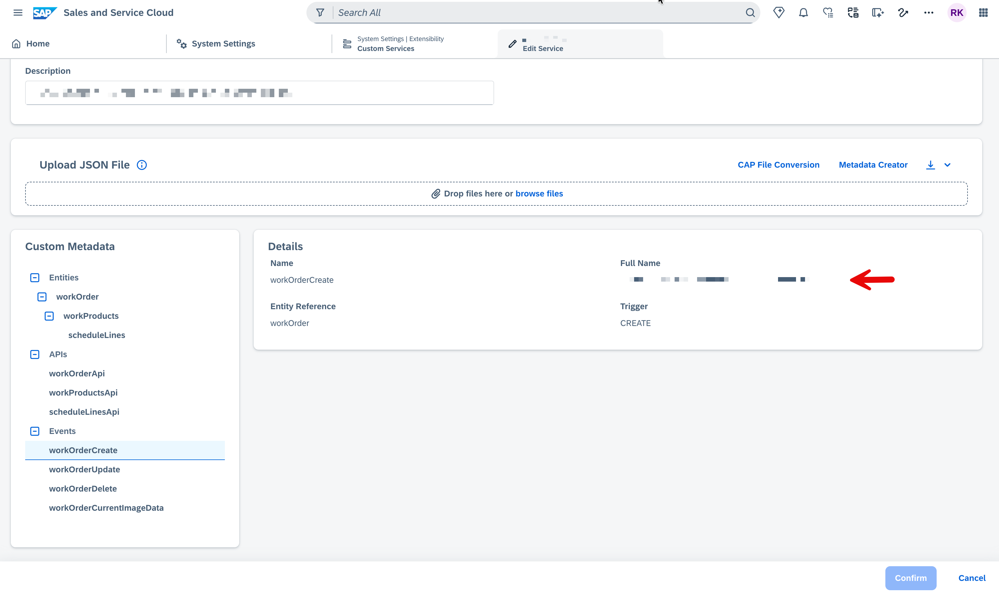

# Analytics Data Export Events - WorkOrder Service

## Overview

When SSC V2 triggers a **Data Export Request**, the service fires a sequence of CloudEvents to replicate all WorkOrder data into the analytics pipeline:

```
PLAN  →  DATA (one per record)  →  SUMMARY
```

All three phases use the same CloudEvent `type` (`workOrderCurrentImageData`). The phase is distinguished by the `data.type` field (`"PLAN"`, `"DATA"`, or `"SUMMARY"`).

> For CUD events (Create / Update / Delete), see [`CUD_EVENTS.md`](./CUD_EVENTS.md).

---

## Entity Hierarchy

```
WorkOrder
  |-- projectLead        (expanded from projectLeadId via EmployeeService)
  |-- estimatedRevenue   (composed from currencyCode + content)
  +-- workProducts[]
        |-- estimatedRevenue  (composed from currencyCode + content)
        +-- scheduleLines[]
```

---

## CloudEvent Envelope Structure

```json
{
  "id": "<UUID>",
  "subject": "<dataRequestId>",
  "type": "customer.ssc.workorderservice.event.workOrderCurrentImageData",
  "specversion": "0.2",
  "source": "<SSC_TENANT_SOURCE_ID>",
  "time": "<ISO datetime>",
  "datacontenttype": "application/json",
  "data": { ... }
}
```

---

## Event Type String

The `type` field maps to the **Full Name** of the `DATA_EXPORT_REQUEST` event registered in the SSC Custom Service.

**To find the correct value:** Go to **System Settings → Extensibility → Custom Services → Edit Service → Events**, select the data export request event, and copy its **Full Name**.



| SSC Trigger | CloudEvent `type` |
|-------------|-------------------|
| `DATA_EXPORT_REQUEST` | `customer.ssc.workorderservice.event.workOrderCurrentImageData` |

---

## Transformation Rules (Raw Entity → Analytics Payload)

| Entity | Field(s) Removed / Transformed |
|--------|-------------------------------|
| **WorkOrder** | `projectLeadId` → expanded to `projectLead { id, formattedName, displayId }` (omitted if null) |
| | `currencyCode` + `content` → composed into `estimatedRevenue { currencyCode, content }` (omitted if null) |
| | `startDate` / `endDate` → converted to ISO datetime strings |
| **WorkProduct** | `currencyCode` + `content` → composed into `estimatedRevenue { currencyCode, content }` |
| | `workOrderId` stripped |
| **ScheduleLine** | `workProductId` stripped |
| | `createdAt` / `updatedAt` stripped |
| | `date` / `requestedEndDate` → converted to ISO datetime strings |
| | `requestedQuantity` / `confirmedQuantity` → cast to Number |

---

## Sample Payloads

### 1. PLAN Event

```json
{
  "id": "11111111-aaaa-bbbb-cccc-dddddddddddd",
  "subject": "req-00001111-2222-3333-4444-555566667777",
  "type": "customer.ssc.workorderservice.event.workOrderCurrentImageData",
  "specversion": "0.2",
  "source": "<your-ssc-tenant-source-id>",
  "time": "2026-03-26T08:00:00.000Z",
  "datacontenttype": "application/json",
  "data": {
    "dataRequestId": "req-00001111-2222-3333-4444-555566667777",
    "entityFullName": "customer.ssc.workorderservice.entity.workOrder",
    "serviceFullName": "customer.ssc.service.workOrderService",
    "type": "PLAN",
    "count": 42
  }
}
```

---

### 2. DATA Event (one per record)

```json
{
  "id": "22222222-bbbb-cccc-dddd-eeeeeeeeeeee",
  "subject": "req-00001111-2222-3333-4444-555566667777",
  "type": "customer.ssc.workorderservice.event.workOrderCurrentImageData",
  "specversion": "0.2",
  "source": "<your-ssc-tenant-source-id>",
  "time": "2026-03-26T08:00:05.000Z",
  "datacontenttype": "application/json",
  "data": {
    "dataRequestId": "req-00001111-2222-3333-4444-555566667777",
    "entityFullName": "customer.ssc.workorderservice.entity.workOrder",
    "serviceFullName": "customer.ssc.service.workOrderService",
    "type": "DATA",
    "currentImage": {
      "id": "f47ac10b-58cc-4372-a567-0e02b2c3d479",
      "status": "ACTIVE",
      "startDate": "2026-04-01T00:00:00.000Z",
      "endDate": "2026-12-31T00:00:00.000Z",
      "orderName": "Cloud Migration Project",
      "numberOfSubscriptions": "5",
      "displayId": "WO-001",
      "caseDisplayId": "CS-2026-0042",
      "Customer": "Acme Corporation",
      "createdAt": "2026-03-26T10:15:29.000Z",
      "updatedAt": "2026-03-26T10:15:29.000Z",
      "estimatedRevenue": {
        "currencyCode": "USD",
        "content": 150000
      },
      "projectLead": {
        "id": "e12a34b5-6789-0abc-def1-234567890abc",
        "formattedName": "John Smith",
        "displayId": "EMP-1001"
      },
      "workProducts": [
        {
          "id": "c23d45e6-7890-1bcd-ef23-456789012bcd",
          "workProductId": "WP-101",
          "workProductName": "Data Migration Service",
          "customizationDetails": "Full ETL pipeline setup",
          "quantity": 1,
          "productCategory": "Services",
          "completionPercentage": 0,
          "productTypeCode": "SVC",
          "status": "In Progress",
          "createdAt": "2026-03-26T10:15:29.000Z",
          "updatedAt": "2026-03-26T10:15:29.000Z",
          "estimatedRevenue": {
            "currencyCode": "USD",
            "content": 75000
          },
          "scheduleLines": [
            {
              "id": "d34e56f7-8901-2cde-f345-678901234cde",
              "displayId": "SL-001",
              "scheduleLineName": "Phase 1 Delivery",
              "date": "2026-06-01T00:00:00.000Z",
              "requestedQuantity": 1,
              "confirmedQuantity": 1,
              "requestedEndDate": "2026-06-30T00:00:00.000Z",
              "status": "Open"
            }
          ]
        }
      ]
    }
  }
}
```

---

### 3. SUMMARY Event (Success)

```json
{
  "id": "33333333-cccc-dddd-eeee-ffffffffffff",
  "subject": "req-00001111-2222-3333-4444-555566667777",
  "type": "customer.ssc.workorderservice.event.workOrderCurrentImageData",
  "specversion": "0.2",
  "source": "<your-ssc-tenant-source-id>",
  "time": "2026-03-26T08:05:00.000Z",
  "datacontenttype": "application/json",
  "data": {
    "dataRequestId": "req-00001111-2222-3333-4444-555566667777",
    "entityFullName": "customer.ssc.workorderservice.entity.workOrder",
    "serviceFullName": "customer.ssc.service.workOrderService",
    "type": "SUMMARY",
    "status": "SUCCESS",
    "count": 42
  }
}
```

---

### 4. SUMMARY Event (Aborted)

```json
{
  "id": "44444444-dddd-eeee-ffff-aaaaaaaaaaaa",
  "subject": "req-00001111-2222-3333-4444-555566667777",
  "type": "customer.ssc.workorderservice.event.workOrderCurrentImageData",
  "specversion": "0.2",
  "source": "<your-ssc-tenant-source-id>",
  "time": "2026-03-26T08:03:00.000Z",
  "datacontenttype": "application/json",
  "data": {
    "dataRequestId": "req-00001111-2222-3333-4444-555566667777",
    "entityFullName": "customer.ssc.workorderservice.entity.workOrder",
    "serviceFullName": "customer.ssc.service.workOrderService",
    "type": "SUMMARY",
    "status": "ABORTED",
    "count": 0,
    "errorMessage": "Connection timeout while fetching records",
    "errorCode": "REPLICATION_ERROR"
  }
}
```

---

## Configuration

| Variable | Description |
|----------|-------------|
| `SSC_TENANT_SOURCE_ID` | Source ID of your SSC tenant registered in the analytics system |
| `SSC_BTP_DESTINATION` | BTP Destination name pointing to the SSC tenant's analytics inbound connector |

> If either variable is not configured, the data export request is silently skipped and all other service functionality works normally.
